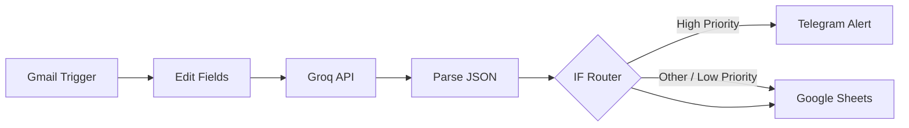
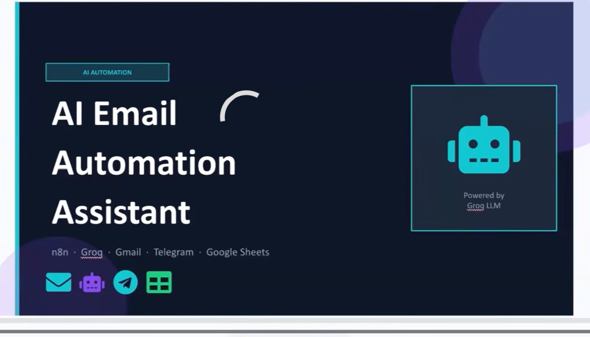
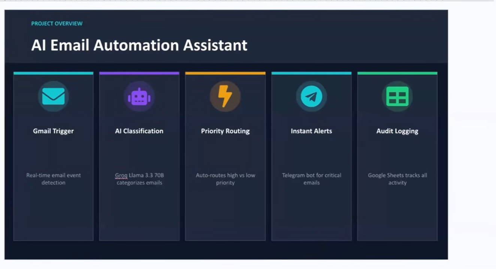
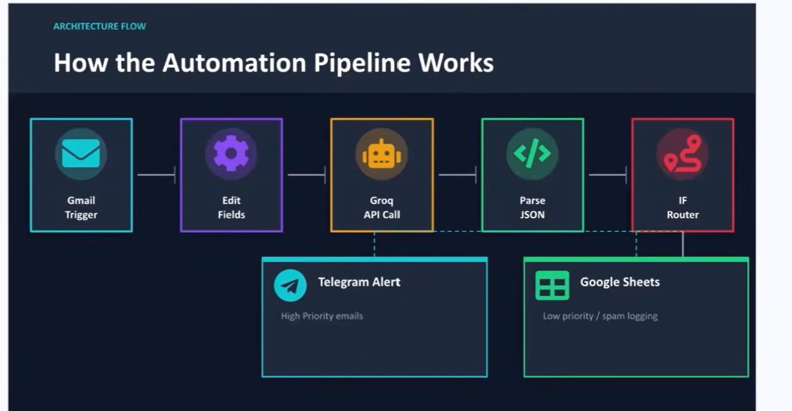
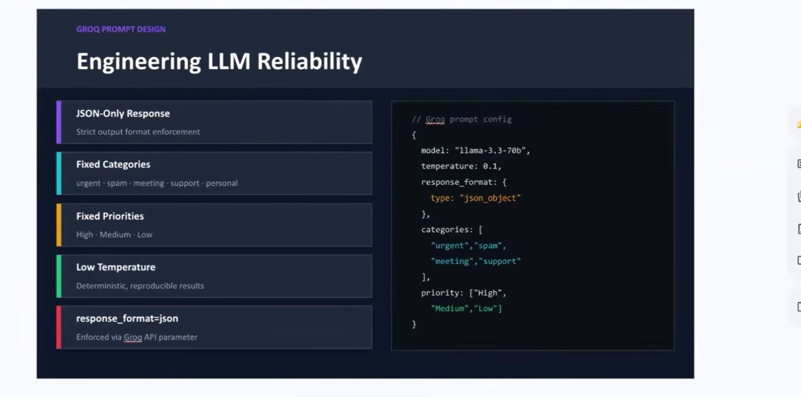

# AI Email Automation Assistant

> An AI-powered email triage and automation workflow built with **n8n, Gmail, Groq LLM, Telegram, and Google Sheets**.

The system monitors incoming Gmail messages, prepares the email content, sends it to a Groq-hosted LLM for classification, parses the structured result, routes the email according to priority, sends Telegram alerts for high-priority messages, and records activity in Google Sheets.

---

## 🚀 Project Overview

The **AI Email Automation Assistant** is designed to reduce manual email triage.

Instead of checking every incoming email manually, the workflow:

1. Detects a new email using the Gmail Trigger.
2. Extracts/organizes the useful email fields.
3. Sends the email subject and body to a Groq LLM.
4. Classifies the message and determines its priority.
5. Parses the model response into structured fields.
6. Routes the result using an IF condition.
7. Sends an alert for high-priority messages.
8. Logs processed activity in Google Sheets.

### Main Technologies

| Technology | Purpose |
|---|---|
| **n8n** | Workflow orchestration and automation |
| **Gmail Trigger** | Detects incoming emails |
| **Groq API** | LLM inference |
| **Llama 3.3 70B** | Email classification |
| **Telegram** | High-priority notifications |
| **Google Sheets** | Audit/activity logging |
| **Python / Code node** | Parsing and normalizing model output |

---

## 🎯 Core Features

- 📩 **Automatic Gmail monitoring**
- 🤖 **AI-based email classification**
- ⚡ **Priority detection**
- 🚨 **Telegram alerts for high-priority emails**
- 📊 **Google Sheets audit logging**
- 🧾 **Structured JSON output**
- 🔐 **Credentials kept inside n8n rather than source files**
- 🔄 **Fully automated n8n workflow**

---

## 🏗️ Architecture



### Detailed flow

**Gmail → Edit Fields → Groq API → Parse JSON → IF Router**

From the router:

- **High priority** → Telegram notification + logging
- **Other/Low priority** → Google Sheets logging
- Additional branches can be added later for spam, meetings, support, etc.

---

## 🔍 Workflow Steps

### 1. Gmail Trigger

The workflow starts when a new Gmail event is detected.

The incoming Gmail data can contain fields such as:

- Subject
- Body / snippet
- Sender
- Thread ID
- Message ID
- Labels
- Internal date

The workflow uses the email content for classification.

---

### 2. Edit Fields

The **Edit Fields** node prepares the information required by the AI request.

Example input:

```text
Subject: Interview schedule for tomorrow

Email Body:
Hello Chetan,
Your technical interview has been scheduled for tomorrow at 10:00 AM.
Please confirm your availability.
```

The prepared subject/body is passed to the Groq API.

---

### 3. Groq API / LLM Classification

The email is sent to the Groq API.

The model used in the documented workflow is:

```text
openai/gpt-oss-120b
```

The project presentation also documents the Llama 3.3 70B classification design. Keep the model name in the README synchronized with the model configured in your current exported n8n workflow.

The prompt is designed to produce a structured response rather than free-form text.

Example target structure:

```json
{
  "category": "urgent",
  "priority": "High",
  "reply": true
}
```

---

## 🧠 Prompt Design

The workflow uses constraints to make the LLM output easier to process.

### JSON-only output

The model is instructed to return structured JSON.

### Fixed categories

The project design documents categories such as:

```text
urgent
spam
meeting
support
```

If your current prompt contains a different category list, update this section to match the exported workflow.

### Fixed priorities

```text
High
Medium
Low
```

### Deterministic behavior

A low temperature is used in the documented prompt design to reduce unnecessary variation in classification results.

---

## 🧾 JSON Parsing

The LLM response is expected to contain structured JSON.

Example:

```json
{
  "category": "urgent",
  "priority": "High",
  "reply": true
}
```

The parsing stage converts the model response into fields that n8n can use:

```text
category
priority
reply
```

This makes the next IF node independent of the raw LLM response format.

> **Important:** Do not rely on a Python `json` import in n8n Cloud if your instance blocks standard-library imports. Prefer n8n expressions, a structured-output parser, or JavaScript Code where appropriate. The current workflow should use the parsing method that is actually working in your exported JSON.

---

## ⚡ Priority Routing

The IF Router checks the structured fields.

Example condition:

```text
priority == "High"
```

If true:

```text
Telegram Alert
      ↓
Google Sheets logging
```

If false:

```text
Google Sheets logging
```

This allows important messages to be surfaced immediately while still maintaining an audit trail.

---

## 📱 Telegram Alert

High-priority emails can be sent to a Telegram bot/channel.

Example notification:

```text
🚨 HIGH PRIORITY EMAIL

Category: urgent
Priority: High

Subject:
Technical Interview Confirmation

Action:
Review immediately.
```

The exact notification format can be customized in the Telegram node.

---

## 📊 Google Sheets Audit Logging

The workflow records processed email information in Google Sheets.

Typical columns can include:

| Field | Example |
|---|---|
| Timestamp | 2026-09-28 15:24 |
| Category | urgent |
| Priority | High |
| Reply Required | true |
| Subject | Interview Confirmation |
| Sender | example@example.com |

This provides a simple activity/audit history.

---

# 🔄 Complete End-to-End Flow

```text
                 ┌─────────────────┐
                 │   Gmail Trigger │
                 └────────┬────────┘
                          │
                          ▼
                 ┌─────────────────┐
                 │   Edit Fields   │
                 │ Subject + Body  │
                 └────────┬────────┘
                          │
                          ▼
                 ┌─────────────────┐
                 │    Groq API     │
                 │  LLM Classifier │
                 └────────┬────────┘
                          │
                          ▼
                 ┌─────────────────┐
                 │   Parse JSON    │
                 │ category        │
                 │ priority        │
                 │ reply           │
                 └────────┬────────┘
                          │
                          ▼
                   ┌─────────────┐
                   │ IF Router   │
                   └──────┬──────┘
                          │
              ┌───────────┴───────────┐
              │                       │
        High Priority             Not High
              │                       │
              ▼                       │
      ┌───────────────┐               │
      │ Telegram      │               │
      │ Alert         │               │
      └───────┬───────┘               │
              │                       │
              └───────────┬───────────┘
                          ▼
                 ┌─────────────────┐
                 │ Google Sheets   │
                 │ Audit Logging   │
                 └─────────────────┘
```

---

## 🧪 Example

### Incoming email

```text
From: hr@company.com
Subject: Interview Confirmation

Your technical interview is confirmed for tomorrow at 10:00 AM.
Please confirm your availability.
```

### AI result

```json
{
  "category": "urgent",
  "priority": "High",
  "reply": true
}
```

### Routing

```text
priority = High
        ↓
IF = TRUE
        ↓
Telegram Alert
        ↓
Google Sheets Log
```

---

## 🛠️ n8n Workflow Structure

The main workflow contains the following logical nodes:

```text
Gmail Trigger
    ↓
Edit Fields
    ↓
HTTP Request / Groq API
    ↓
Code / JSON Parsing
    ↓
IF
    ├── TRUE  → Telegram
    │             ↓
    │         Google Sheets
    │
    └── FALSE → Google Sheets
```

The exact node names may differ slightly between exported workflow versions.

---

# 🔐 Security & Credentials

**Never commit real credentials to GitHub.**

Do not put any of these inside the repository:

```text
Gmail OAuth tokens
Groq API keys
Telegram bot tokens
Google credentials
n8n API keys
```

For n8n:

- Store credentials using n8n's credential system.
- Keep API keys in credential fields or environment variables.
- Export the workflow only after removing/replacing sensitive values where necessary.
- Before uploading an exported JSON workflow, inspect it for tokens, authorization headers, IDs, and secrets.

Recommended repository pattern:

```text
AI-Email-Automation-Assistant/
├── README.md
├── WORKFLOW.md
├── SECURITY.md
├── workflow/
│   └── ai-email-automation.json
└── docs/
    └── images/
```

If a credential was accidentally exposed, revoke/rotate it immediately.

---

# 📦 How to Run / Import

## Option 1 — Import into n8n

1. Open your n8n instance.
2. Create/open a project.
3. Import the exported workflow JSON.
4. Reconnect your own credentials.
5. Configure:
   - Gmail
   - Groq
   - Telegram
   - Google Sheets
6. Review the IF conditions.
7. Send a test email.
8. Check the execution log.

### Important

The exported workflow is a **workflow definition**, not a portable copy of your private credentials.

You should configure your own credentials after importing.

---

# 🧪 Testing Checklist

Test at least these cases:

### Test 1 — High priority

```text
Subject: Interview scheduled tomorrow
Expected: High
Expected route: Telegram + Google Sheets
```

### Test 2 — Normal email

```text
Subject: General newsletter
Expected: Low
Expected route: Google Sheets
```

### Test 3 — Meeting

```text
Subject: Team meeting at 4 PM
Expected: meeting
Expected priority: Medium/High depending on prompt rules
```

### Test 4 — Spam

```text
Subject: Congratulations! You won a prize
Expected: spam
Expected route: logging / spam branch
```

---

# 📈 Future Improvements

Possible next versions:

- ✉️ AI-generated email replies
- 🗂️ Automatic Gmail labels
- 📅 Calendar integration for meeting emails
- 🧠 More robust structured-output validation
- 📊 Dashboard for email statistics
- 🔔 Separate alerts for different priority levels
- 🛡️ Spam/phishing detection
- 👤 Sender-based priority rules
- 🧵 Thread-aware email classification
- 🔁 Human approval before sending AI-generated replies

---

# 📸 Project Visuals

### Project Overview



### Architecture Flow



### LLM Prompt Design



### LLM JSON Output / Flow



---

# 📁 Repository Structure

```text
AI-Email-Automation-Assistant/
│
├── README.md
├── WORKFLOW.md
├── SECURITY.md
│
├── workflow/
│   └── ai-email-automation.json
│
└── docs/
    └── images/
        ├── 01-project-overview.png
        ├── 02-architecture-flow.png
        ├── 03-llm-prompt-design.png
        └── 04-llm-json-output-flow.png
```

---

# 👨‍💻 Project

**AI Email Automation Assistant**

**Author : Chetan Kumar N k**

Built using:

**n8n • Gmail • Groq • LLM • Telegram • Google Sheets**

This project demonstrates how AI can be integrated with workflow automation to classify incoming emails, route important messages, and maintain an activity log.
