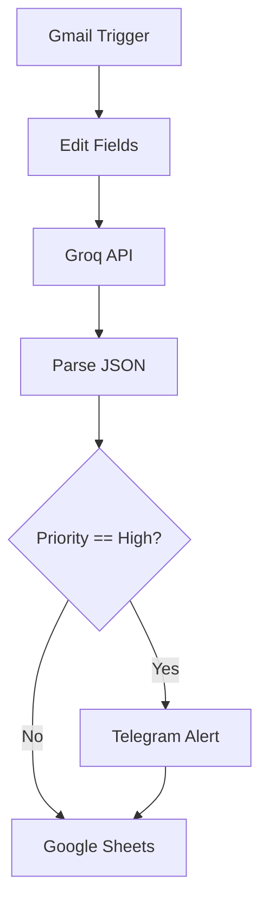

# Workflow Documentation — AI Email Automation Assistant

## 1. High-Level Flow



## 2. Node Responsibilities

### Gmail Trigger
Receives new Gmail events and supplies the message metadata/content.

### Edit Fields
Selects and prepares the email fields needed by the classifier.

Typical data:
- Subject
- Body/snippet
- Sender
- Message/thread identifiers

### Groq API
Sends the prepared email to the configured LLM.

The prompt asks for structured classification:
- `category`
- `priority`
- `reply`

### Parse JSON
Converts the model response into normal n8n fields.

Target shape:

```json
{
  "category": "urgent",
  "priority": "High",
  "reply": true
}
```

### IF Router
Checks the priority.

Primary routing rule:

```text
priority == "High"
```

### Telegram
Receives an alert when the email is high priority.

### Google Sheets
Stores the classification/routing result for auditing.

---

## 3. Data Flow

```text
Gmail message
    ↓
subject + body
    ↓
Groq classification
    ↓
structured JSON
    ↓
category / priority / reply
    ↓
IF router
    ↓
┌───────────────────┬───────────────────┐
│ High              │ Not High          │
▼                   ▼
Telegram            Google Sheets
│
└───────────────┐
                ▼
          Google Sheets
```

---

## 4. LLM Contract

The downstream workflow should receive predictable fields.

Recommended contract:

```json
{
  "category": "urgent",
  "priority": "High",
  "reply": true
}
```

Allowed priority values:

```text
High
Medium
Low
```

The category list should match the categories defined in the current prompt.

---

## 5. Failure Handling

If the LLM returns malformed output:

1. Do not silently route it as high priority.
2. Preserve the original email data where possible.
3. Record the failure in the audit log.
4. Review the failed execution in n8n.
5. Prefer structured output/schema enforcement over fragile text splitting.

---

## 6. Security Flow

```text
                    ┌──────────────────┐
                    │ n8n Credentials   │
                    └────────┬─────────┘
                             │
       ┌─────────────────────┼─────────────────────┐
       ▼                     ▼                     ▼
     Gmail                 Groq                 Telegram
       │                     │                     │
       └─────────────────────┼─────────────────────┘
                             ▼
                       n8n Workflow
                             │
                             ▼
                       Google Sheets
```

Credentials should remain in n8n and should not be committed to Git.

---

## 7. Demo Flow

For a portfolio demonstration:

```text
1. Send a test email
        ↓
2. Gmail Trigger detects it
        ↓
3. n8n prepares the message
        ↓
4. Groq classifies it
        ↓
5. JSON is parsed
        ↓
6. IF checks priority
        ↓
7. Telegram alert appears if High
        ↓
8. Google Sheets receives the log
```

A good demo should show the n8n execution graph and the resulting Telegram/Sheets output without exposing private email content or credentials.
